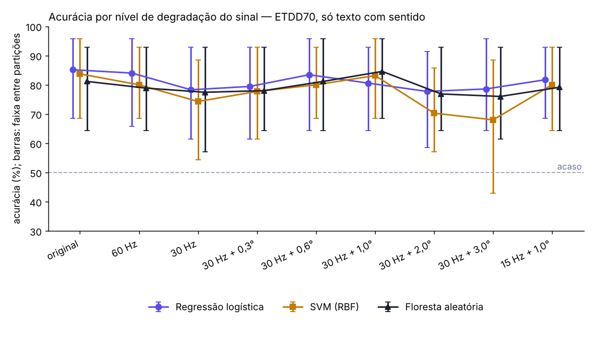

# Resultados do experimento — ETDD70, só texto com sentido

Gerado em 2026-10-13 18:27 UTC. Validação cruzada estratificada com separação por participante, 5 partições x 5 repetições, semente 0.

## Coorte

- 70 participantes, 35 com dislexia
- 70 gravações usadas; 0 removidas por perda de rastreamento acima de 25%
- por tarefa: Texto com sentido 70
- taxa de amostragem: 250 Hz

## 1. Comparação entre modelos (sinal original)

| Modelo | Acurácia (faixa entre partições) | Sensibilidade | Especificidade | AUC | VPP a 10% |
|---|---|---|---|---|---|
| Regressão logística | 85,1% (68,6–95,7) | 84,6% | 85,7% | 94,6% | 39,7% |
| SVM (RBF) | 83,7% (68,6–95,7) | 81,1% | 86,3% | 90,9% | 39,7% |
| Floresta aleatória | 81,1% (64,3–92,9) | 78,9% | 83,4% | 90,5% | 34,6% |

VPP: das crianças que o modelo apontaria numa escola com prevalência de 10%, quantas de fato teriam dislexia. A base é balanceada (metade com dislexia), então a acurácia sozinha superestima o uso real.

## 2. Comparação entre tarefas (acurácia, sinal original)

| Tarefa | Regressão logística | SVM (RBF) | Floresta aleatória |
|---|---|---|---|
| Texto com sentido | 85,1% | 83,7% | 81,1% |

## 3. Curva de degradação (acurácia)

| Nível | Regressão logística | SVM (RBF) | Floresta aleatória |
|---|---|---|---|
| original | 85,1% | 83,7% | 81,1% |
| 60 Hz | 84,0% | 80,0% | 78,9% |
| 30 Hz | 78,3% | 74,3% | 77,4% |
| 30 Hz + 0,3° | 79,4% | 77,7% | 78,0% |
| 30 Hz + 0,6° | 83,4% | 80,0% | 81,1% |
| 30 Hz + 1,0° | 80,6% | 83,1% | 84,6% |
| 30 Hz + 2,0° | 77,7% | 70,3% | 76,9% |
| 30 Hz + 3,0° | 78,6% | 68,0% | 76,0% |
| 15 Hz + 1,0° | 81,7% | 80,0% | 79,1% |

O aplicativo opera perto de **30 Hz + 2,0° a 3,0°** (calibração geométrica pela íris). É nessas linhas que se lê o que o sistema instalado pode entregar.
