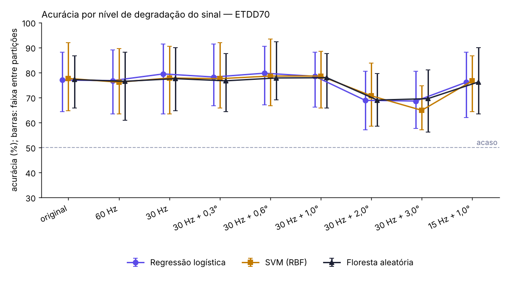

# Resultados do experimento — ETDD70

Gerado em 2026-10-13 18:22 UTC. Validação cruzada estratificada com separação por participante, 5 partições x 5 repetições, semente 0.

## Coorte

- 70 participantes, 35 com dislexia
- 210 gravações usadas; 0 removidas por perda de rastreamento acima de 25%
- por tarefa: Pseudotexto 70, Sílabas 70, Texto com sentido 70
- taxa de amostragem: 250 Hz

## 1. Comparação entre modelos (sinal original, três tarefas)

| Modelo | Acurácia (faixa entre partições) | Sensibilidade | Especificidade | AUC | VPP a 10% |
|---|---|---|---|---|---|
| Regressão logística | 77,0% (64,3–88,1) | 73,0% | 81,0% | 86,7% | 29,9% |
| SVM (RBF) | 77,6% (64,8–91,9) | 69,9% | 85,3% | 86,5% | 34,6% |
| Floresta aleatória | 77,1% (65,7–86,7) | 74,5% | 79,8% | 86,2% | 29,1% |

VPP: das crianças que o modelo apontaria numa escola com prevalência de 10%, quantas de fato teriam dislexia. A base é balanceada (metade com dislexia), então a acurácia sozinha superestima o uso real.

## 2. Comparação entre tarefas (acurácia, sinal original)

| Tarefa | Regressão logística | SVM (RBF) | Floresta aleatória |
|---|---|---|---|
| Pseudotexto | 82,3% | 85,7% | 84,6% |
| Sílabas | 80,3% | 79,1% | 76,6% |
| Texto com sentido | 85,1% | 83,7% | 81,1% |

## 3. Curva de degradação (acurácia)

| Nível | Regressão logística | SVM (RBF) | Floresta aleatória |
|---|---|---|---|
| original | 77,0% | 77,6% | 77,1% |
| 60 Hz | 76,8% | 76,1% | 76,5% |
| 30 Hz | 79,4% | 77,8% | 77,5% |
| 30 Hz + 0,3° | 78,2% | 77,5% | 76,7% |
| 30 Hz + 0,6° | 79,7% | 78,6% | 77,8% |
| 30 Hz + 1,0° | 78,5% | 78,6% | 77,9% |
| 30 Hz + 2,0° | 68,9% | 70,7% | 69,0% |
| 30 Hz + 3,0° | 68,6% | 64,9% | 69,5% |
| 15 Hz + 1,0° | 76,1% | 76,7% | 76,2% |

O aplicativo opera perto de **30 Hz + 2,0° a 3,0°** (calibração geométrica pela íris). É nessas linhas que se lê o que o sistema instalado pode entregar.
